<div align="center">

# 🧠 Deep Learning PyTorch Classifier

### Image Classification with Convolutional Neural Networks

**A practical computer vision project built with Python, PyTorch and Google Colab**


</div>

---

## 🎯 1. Project Purpose — From Model Training to Business Solutions

This project demonstrates an end-to-end image-classification workflow using a Convolutional Neural Network (CNN) implemented with PyTorch, trained and evaluated on the CIFAR-10 dataset.

The objective is to demonstrate how a deep learning model can be developed, evaluated, saved, reused and progressively improved as part of a broader software solution.

The workflow covers data preparation, model architecture, training, test-set evaluation, model persistence and predictions on external images. Google Colab provides the cloud-based notebook environment used for experimentation and access to the compute hardware available during a session.

## ✨ What This Project Delivers

- 🧠 A CNN model named ConvNet, trained to classify images into the ten CIFAR-10 categories.
- 📊 A measurable evaluation result, including an overall test accuracy of 63.86% in the recorded run.
- 💾 A saved model that can be downloaded and reused for inference without repeating the original training process.
- 🖼️ Practical tests using external images to demonstrate predictions, limitations and misclassifications.
- 🔄 A foundation for further experimentation, model improvement and integration into applications.

## 🏗️ 2. Solution Approach — What I Built and How

The project follows a practical machine learning workflow:

Prepare the data: load CIFAR-10, transform images into tensors and normalise pixel values.
Build the model: define a CNN architecture with convolutional layers, max-pooling and fully connected layers.
Train the network: use a training loop with Cross-Entropy Loss and the Adam optimiser.
Evaluate performance: measure overall test accuracy and examine performance across individual classes.
Save and reuse the model: persist the learned weights so the trained model can be loaded in a later session or separate environment.
Test real predictions: run inference on external images and analyse both correct predictions and errors.

This structure separates the model-training stage from the application stage. Training produces a reusable model artifact; another component can subsequently load that artifact and use it to address a specific requirement.

## 💾 3. A Trained Model Is a Starting Point, Not the End

One important outcome of this project is demonstrating that the trained model can be saved, downloaded, published and reused later. Once the model weights are available, the training process does not need to be repeated every time the model is used for inference.

This creates opportunities to develop additional solutions around the trained model, depending on the business requirement:

- 🌐 Web application: allow users to upload an image and receive a classification.
- 🔌 REST API: expose predictions to other applications and services.
- 📱 Mobile or desktop application: make image classification available through a dedicated interface.
- 🏢 Business integration: incorporate predictions into an existing operational process or information system.

These are potential next stages, rather than features already implemented in this notebook. Each would require its own design, implementation and testing.

The key principle is that training a model creates a reusable capability that can become part of a larger software product. The next development stage is determined by the problem the solution needs to solve.

## 🔬 4. Evaluation, Limitations and Continuous Improvement

A trained model is not automatically a perfect model. Its results must be measured, its errors understood and its limitations considered before it is used in a real-world application.

The recorded experiment achieved 63.86% overall accuracy on the CIFAR-10 test set. The notebook's evaluation output and annotated screenshots provide evidence of this result, while the external-image examples demonstrate how the model behaves when making individual predictions.

These two perspectives are important: a test metric summarises performance across a dataset, while individual predictions help reveal specific successes and failures.

The examples also demonstrate that a model can produce an incorrect prediction, even after training. A confidence score should not be interpreted as a guarantee that the predicted class is correct.

Potential improvement work includes:

- ⚙️ Tuning hyperparameters, including the learning rate and number of training epochs.
- 🧠 Experimenting with the network architecture and its layers.
- 🖼️ Reviewing preprocessing, normalisation and input-image characteristics.
- 📚 Testing alternative training configurations and relevant libraries.
- 📈 Analysing class-level performance and additional evaluation metrics.
- 🔄 Retraining the model and comparing the results against the existing baseline.

This creates an iterative development cycle:

Train → Evaluate → Analyse errors → Adjust → Retrain → Compare

The goal is to make evidence-based improvements and seek better performance for the intended use case, rather than assume that an AI model will always produce correct results.

## ✨ 5. Project Highlights
- 🧠 Deep Learning: CNN implementation using PyTorch.
- ☁️ Cloud experimentation: Google Colab notebook workflow.
- 📊 Model evaluation: overall and class-by-class test results.
- 💾 Model persistence: save, download and reload trained weights.
- 🖼️ Inference: test the model using external images.
- 🔍 Critical evaluation: identify misclassifications and recognise model limitations.
- 🚀 Extensibility: establish a foundation for a future API, web application or business solution.

## 🛠️ Tech Stack

| Technology | Role in the project |
|---|---|
| **Python** | Main programming language |
| **PyTorch** | Neural network, training and inference |
| **Torchvision** | Dataset and image transformations |
| **NumPy** | Numerical operations |
| **Matplotlib** | Displaying images and results |
| **Google Colab** | Cloud notebook environment |
| **Jupyter Notebook** | Interactive, cell-based workflow |

## 🗃️ Dataset — CIFAR-10

CIFAR-10 contains **60,000 colour images** across 10 categories, split into 50,000 training images and 10,000 test images.

The classes are airplane, automobile, bird, cat, deer, dog, frog, horse, ship and truck.

🔗 **Dataset source:** [CIFAR-10 — University of Toronto](https://www.cs.toronto.edu/~kriz/cifar.html)

The notebook converts images to tensors and normalises pixel values to approximately `[-1, 1]`.

## 🧩 Model and Training

The notebook defines a CNN called `ConvNet`, using two convolutional layers, max-pooling and three fully connected layers.

| Training setting | Value |
|---|---|
| Dataset | CIFAR-10 |
| Epochs | 10 |
| Batch size | 64 |
| Loss function | Cross-Entropy Loss |
| Optimiser | Adam |
| Evaluation | Overall and per-class test accuracy |

The notebook checks which compute device is available in the runtime. Actual hardware availability depends on the environment and session.

## 📈 Results at a Glance

<div align="center">

# **63.86%**
### Recorded overall accuracy on the CIFAR-10 test set

</div>

This is the result recorded in the notebook run. Results can vary when the model is trained again, depending on factors such as initialisation, hardware and runtime settings.

## 🖼️ Project Walkthrough

The following sections present annotated screenshots from the notebook, following the actual execution flow from environment setup and training to evaluation, model reuse and external-image predictions.

### 1. ☁️ Google Colab and runtime setup

The notebook begins with the environment and library setup, including the check for available compute hardware.

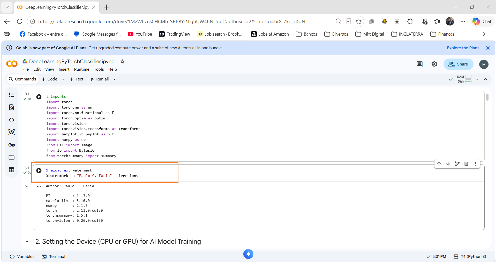

### 2. 🧱 Preparing the model and data

The notebook prepares the image data and defines the CNN components used in the classification workflow.

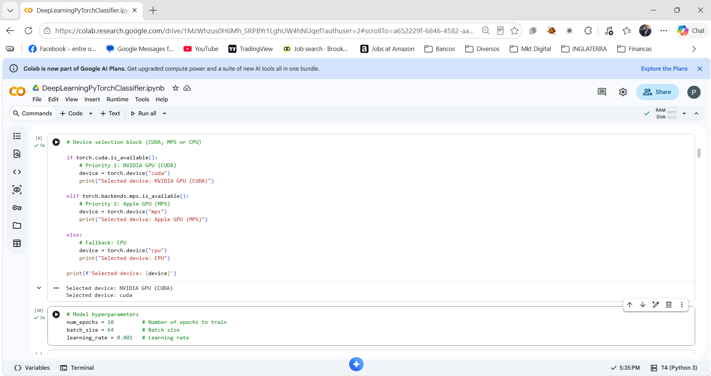

### 3. 🗂️ CIFAR-10 image examples

Sample images illustrate the kind of visual input used during training and evaluation.

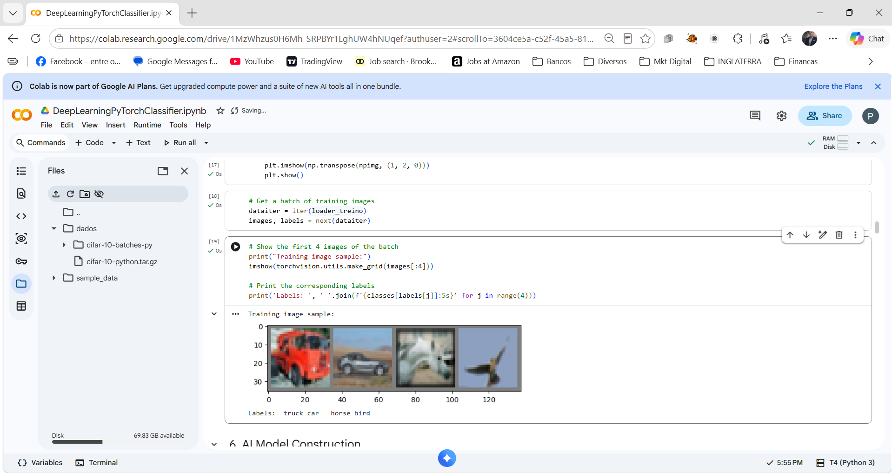

### 4. 🔄 Training and evaluation progress

The notebook runs the training loop and reports evaluation metrics during the experiment.

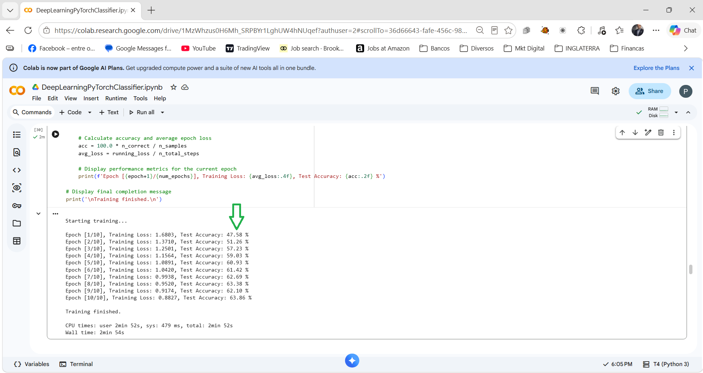

### 5. 🎯 Test accuracy — 63.86%

This annotated result highlights the overall test accuracy recorded in the run. The per-class results also show that performance differs across categories, which is useful when analysing a classifier rather than relying on a single metric.

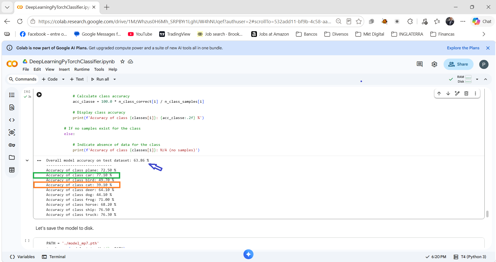

### 6. 💾 Saving and reloading the model

The project demonstrates that a trained deep learning model can be saved, downloaded, and reused in a separate execution environment without repeating the entire training process.

By saving the model's learned weights, the training stage becomes a reusable component that can support further development and real-world applications.

This is an important step towards moving from experimentation to practical implementation. The trained model could become the foundation of a larger solution, such as:

🌐 A web application that classifies uploaded images.
🔌 An API that provides predictions to other systems.
📱 A mobile or desktop application.
🏢 A business solution integrated into an existing operational workflow.

Training the model is therefore not necessarily the end of the project. It can be the starting point for building an application that uses the model to address a specific business need.

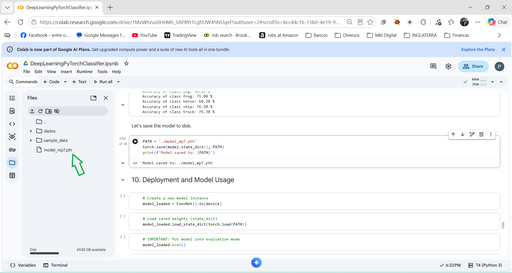

### 7. 🐦 External image prediction — bird

The next stage demonstrates the model's behaviour when applied to individual images, providing practical evidence of its classification capabilities beyond the training process.

The project includes visual examples that connect the notebook's execution results with the model's predictions. The reported 63.86% test accuracy is consistent with the evaluation shown during the experiment, helping connect the quantitative result to the practical workflow.

However, a trained model does not guarantee a correct prediction for every image. The examples also help illustrate the limitations of the current model and the fact that its predictions can be incorrect.

These results provide opportunities for further experimentation and improvement, including:

⚙️ Adjusting hyperparameters, such as the learning rate and number of training epochs.
🧠 Experimenting with the network architecture and its layers.
🖼️ Reviewing image preprocessing, normalisation and input data.
📚 Exploring alternative training configurations and relevant libraries.
🔄 Retraining the model and comparing the resulting evaluation metrics.

This iterative process is an essential part of machine learning development: train, evaluate, identify limitations, adjust, and train again.

The objective is not to assume that an AI model will be perfect, but to understand its performance, measure its limitations, and systematically investigate ways to improve its results.

The key takeaway: this project demonstrates not only how to train a CNN, but also how a trained model can be reused, evaluated, and developed further as part of a larger software or business solution.

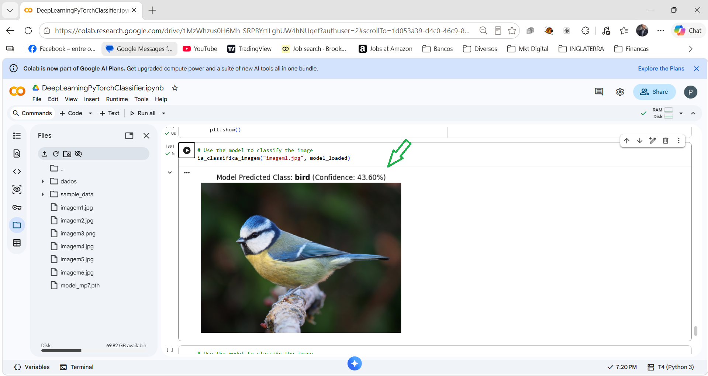

### 8. 🐈 External image prediction — cat

A second example demonstrates inference on a cat image.

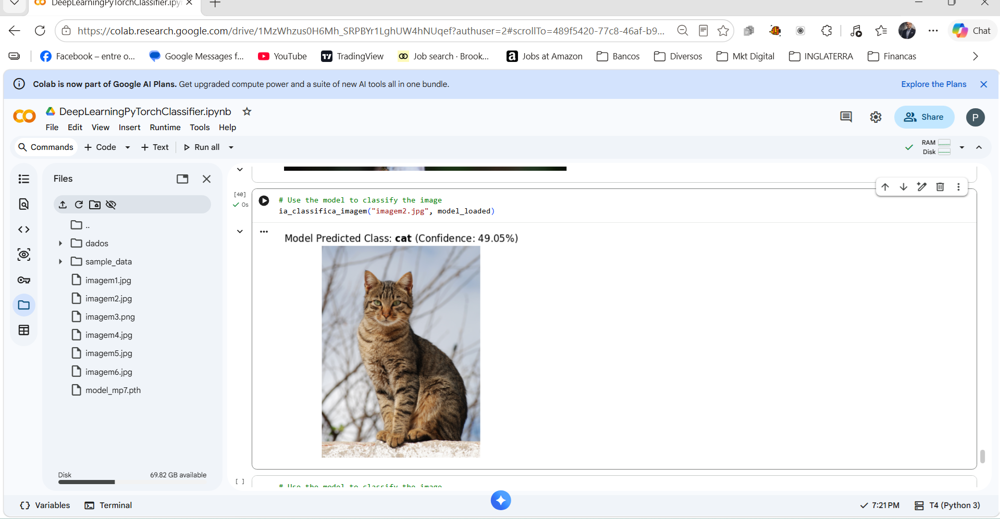

### 9. 🚢 External image prediction — ship

This example shows a prediction for a ship image.


### 10. ✈️ Reviewing a misclassification

The annotated example illustrates an incorrect prediction. It is a useful reminder that a model's prediction—and its confidence value—does not guarantee that the result is correct.

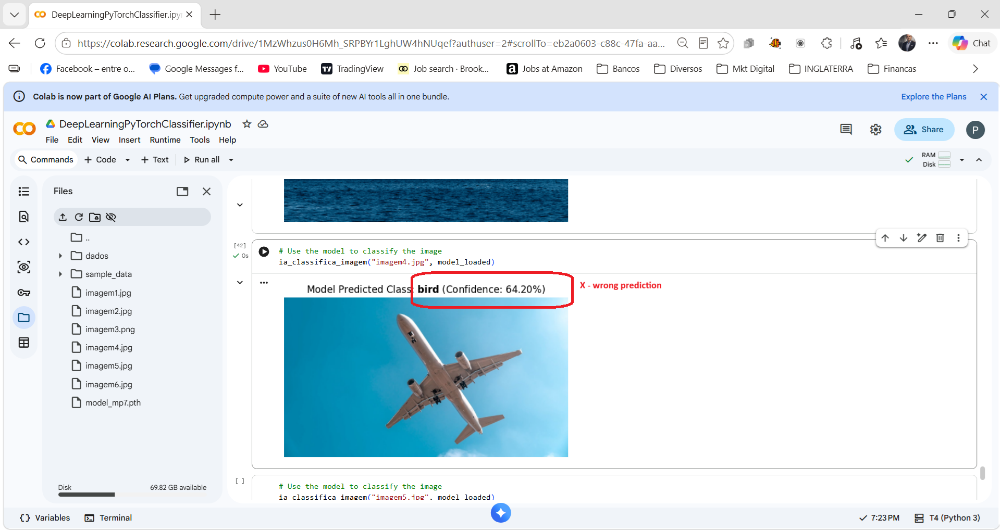

### 11. 🐎 External image prediction — horse

Another inference example tests the trained model on a horse image.

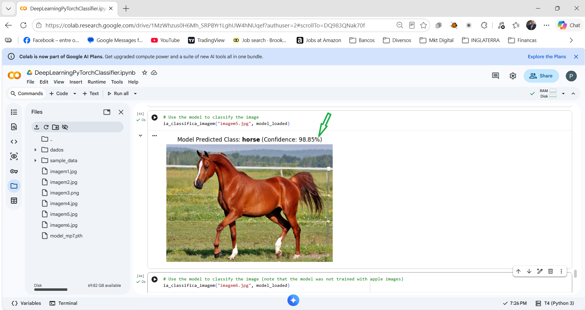

### 12. 🍎 Testing an image outside CIFAR-10

The apple example is outside the ten categories used to train the model. A standard classifier still chooses one of its known classes; this model is not designed to recognise unknown categories as “unknown”.

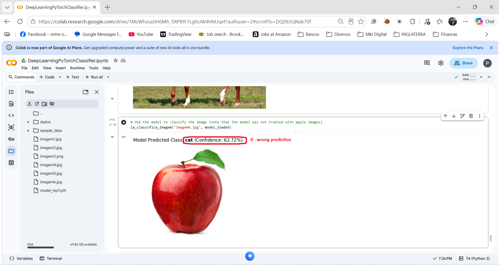

## ▶️ Run in Google Colab

1. Upload the final notebook to Google Drive, or open it directly in Google Colab.
2. Open **Runtime → Change runtime type** and select a GPU if one is available and suitable for the experiment.
3. Run the notebook cells in order.
4. Allow the notebook to download or access CIFAR-10.
5. Review the training output and test metrics.
6. Run the inference cells and make sure any external image files referenced by the notebook are available in the Colab session.

> **Note:** Google Colab does not guarantee GPU availability in every session. The notebook should use the device available to the runtime.

## 💻 Run Locally

1. Create and activate a Python virtual environment.
2. Install the packages listed in `requirements.txt`.
3. Open the notebook in VS Code or Jupyter Notebook.
4. Run the cells in order and confirm that the paths to external images match your local files.

For a local PyTorch installation, use the official [PyTorch installation selector](https://pytorch.org/get-started/locally/) to choose the appropriate command for your operating system and hardware.

## 📁 Repository Structure

```text
DeepLearningPyTorchClassifier/
├── DeepLearningPyTorchClassifier.ipynb
├── README.md
├── requirements.txt
├── images/
└── imgs_proj/
    ├── DeepLearningPyTorchClassifier0.jpeg
    ├── DeepLearningPyTorchClassifier1.jpeg
    ├── ...
    └── DeepLearningPyTorchClassifier11.jpeg
```

Make sure the notebook filename in this structure matches the final notebook you choose to publish. If two notebook versions remain in the folder, select the intended version before committing or clearly document the difference.

## 🔍 Limitations and Next Steps

- The recorded accuracy is a baseline, not a guarantee of performance on unseen real-world images.
- Accuracy varies between CIFAR-10 classes.
- The classifier only predicts among the ten categories it was trained on.
- Possible improvements include data augmentation, experimenting with deeper architectures, analysing a confusion matrix and comparing execution time across hardware.

## 🙌 Acknowledgement

This project was developed as part of a Deep Learning learning activity from **Data Science Academy** and is presented as a portfolio demonstration of a PyTorch image-classification workflow.

---

<div align="center">

**Deep Learning · Computer Vision · PyTorch · Google Colab**

</div>
